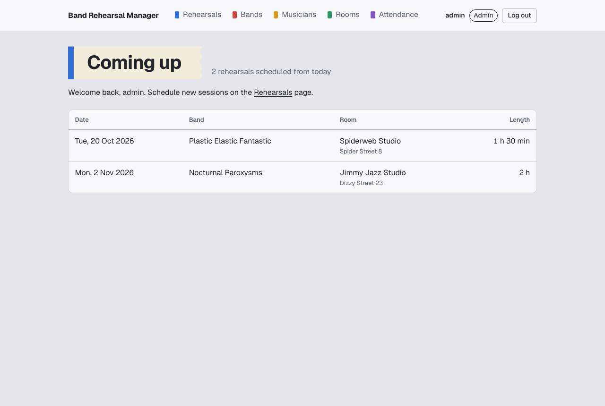
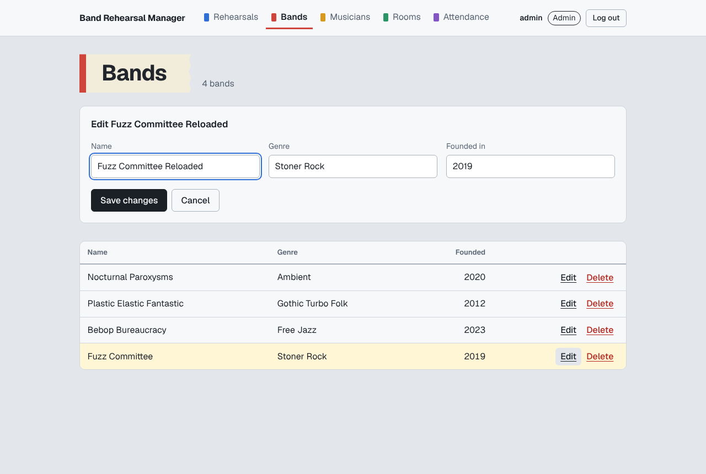
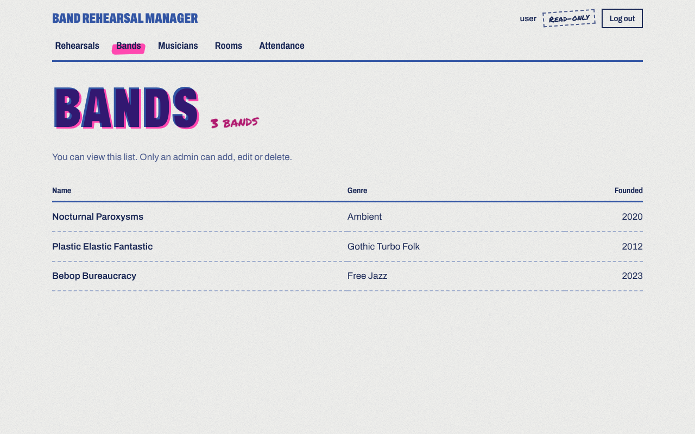
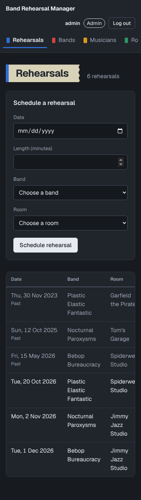
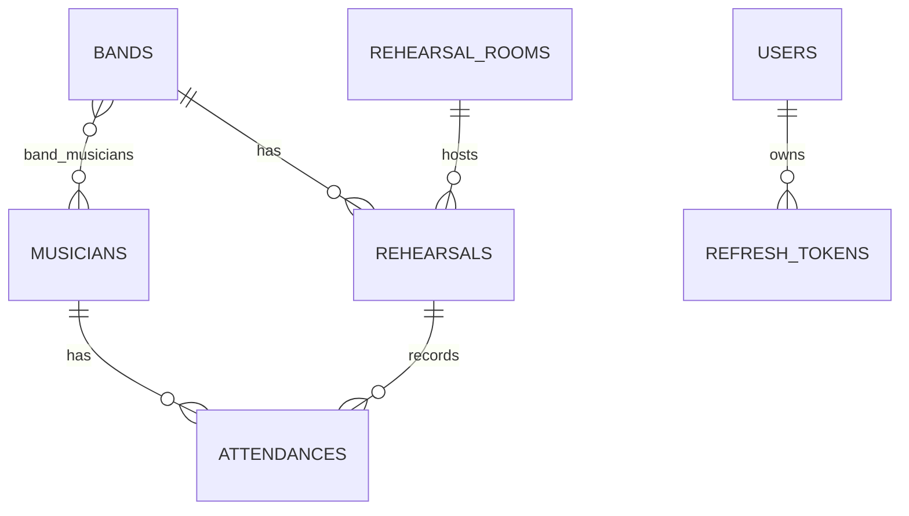
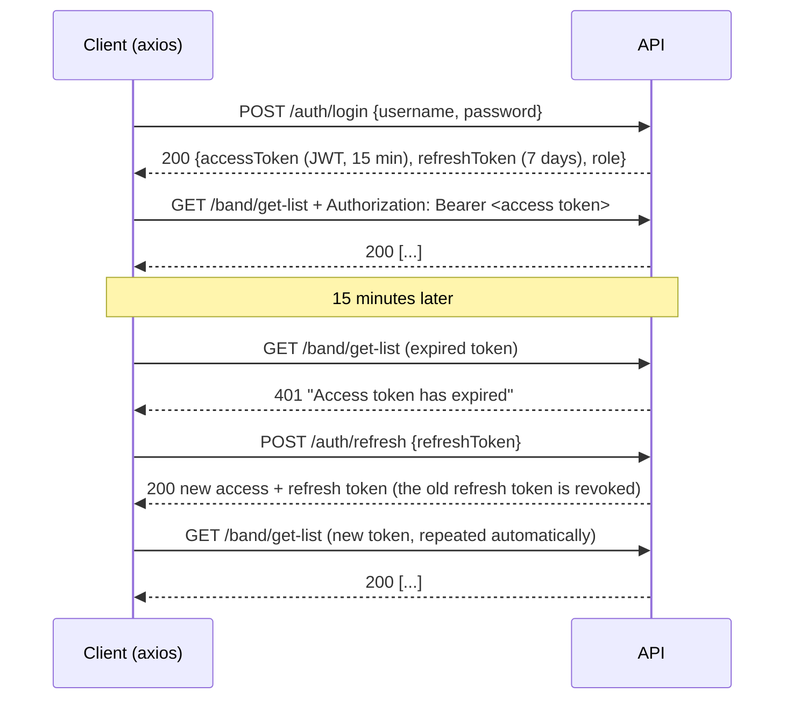

# Band Rehearsal Manager

A web app for a music label to schedule rehearsals for its bands, book rehearsal rooms and keep track of which musicians showed up.

The project is a Spring Boot REST API secured with JWT plus a Next.js front end, organised as one repository with two parts:

```
band-rehearsal-manager/
├── backend/     Spring Boot 4 REST API (Java 21, Spring Security, JPA, MySQL)
├── frontend/    Next.js 16 / React 19 client
├── docs/        Postman collection and screenshots
└── docker-compose.yml
```

Built as the final project for the *Internet Software Architectures* course at Singidunum University.



## Features

- **CRUD for five related tables**: bands, musicians, rehearsals, rehearsal rooms and attendance records.
- **JWT authentication** with short-lived access tokens and long-lived refresh tokens.
- **Automatic token refresh**: when the access token expires, the client renews it in the background and repeats the failed request, so the user is never interrupted.
- **Role-based authorization**: `USER` accounts can read everything, `ADMIN` accounts can also create, update and delete. The API enforces the rules and the UI hides what a role cannot do.
- **Refresh token rotation with reuse detection**: every refresh token works once. Presenting a used token again revokes all of that user's sessions.
- **Consistent errors**: every error is an [RFC 9457](https://www.rfc-editor.org/rfc/rfc9457) *problem details* JSON with the right status (400, 401, 403, 404, 409), including per-field validation messages.
- **Integration tests** for the whole auth flow and the CRUD rules, running against an in-memory H2 database.

| Admin view | Read-only view | Phone, dark mode |
|---|---|---|
|  |  |  |

## Tech stack

| Layer | Technology |
|---|---|
| API | Java 21, Spring Boot 4.1 (Web MVC, Data JPA, Validation, Security), jjwt 0.12 |
| Database | MySQL / MariaDB (H2 in tests) |
| Client | Next.js 16 (App Router), React 19, Axios |
| Tooling | Gradle, npm, Docker Compose, Postman |

## Architecture

The API is layered: **Controller → Service → Repository**, with every service and repository behind an interface (`IBandService`, `IBandRepository`, ...).

- **Controllers** map HTTP requests, validate bodies with `@Valid` and choose status codes (`201 Created`, `204 No Content`).
- **Services** hold the business rules: they load related entities by id, reject unknown references (400), missing records (404) and deletes that would orphan data (409).
- **Repositories** are Spring Data JPA interfaces.
- **`GlobalExceptionHandler`** turns exceptions into problem-details responses. The security layer writes 401/403 in the same format.

### Data model



- **OneToMany**: Band → Rehearsals, Rehearsal Room → Rehearsals, Musician → Attendances, Rehearsal → Attendances, User → Refresh tokens.
- **ManyToMany**: Musician ↔ Band through the `band_musicians` join table (Musician is the owning side).
- Five domain tables plus `users` and `refresh_tokens` for security.

## Authentication and authorization



**Access token**: a JWT signed with HMAC-SHA512. It carries the username (`sub`), the role (`role`), and the issue and expiry times. `JwtAuthenticationFilter` checks the signature and expiry on every request, loads the user and puts their role into the Spring Security context.

**Refresh token**: 256 random bits, not a JWT. The database stores only its SHA-256 hash with an expiry date and a `revoked` flag. `/auth/refresh` revokes the token it receives and returns a new pair. If a revoked token is used again, it was probably copied, so all of that user's refresh tokens are revoked.

**Roles** (in `SecurityConfig`):

| Request | Who |
|---|---|
| `/auth/register`, `/auth/login`, `/auth/refresh`, `/auth/logout` | everyone |
| any `GET` | `USER`, `ADMIN` |
| any `POST`, `PUT`, `DELETE` | `ADMIN` |

New sign-ups always get `USER`. On first start the app creates two demo accounts if they are missing: **admin / admin123** (`ADMIN`) and **user / user123** (`USER`).

**Client side** (`frontend/src/lib/api.js`): one Axios instance adds the access token to every request. On a 401 it calls `/auth/refresh` once and repeats the request. Requests that fail at the same time wait for that one refresh call instead of each starting their own. If the refresh token is rejected, the session ends and the login page explains why.

## API

All CRUD resources (`band`, `musician`, `rehearsal`, `rehearsal-room`, `attendance`) share the same endpoints:

| Method | Path | Role | Success |
|---|---|---|---|
| GET | `/{resource}/get-list` | USER, ADMIN | 200 |
| GET | `/{resource}/get/{id}` | USER, ADMIN | 200, or 404 |
| POST | `/{resource}/create` | ADMIN | 201 |
| PUT | `/{resource}/update` (id in body) | ADMIN | 200, or 404 |
| DELETE | `/{resource}/delete/{id}` | ADMIN | 204, or 409 if still referenced |

| Method | Path | Body | Success |
|---|---|---|---|
| POST | `/auth/register` | `{username, password}` | 201 + tokens |
| POST | `/auth/login` | `{username, password}` | 200 + tokens |
| POST | `/auth/refresh` | `{refreshToken}` | 200 + new tokens |
| POST | `/auth/logout` | `{refreshToken}` | 204 |
| GET | `/auth/me` | none | 200 `{username, role}` |

Related entities are sent by id only, for example:

```json
POST /rehearsal/create
{ "date": "2026-11-20", "durationMinutes": 120, "band": { "id": 1 }, "rehearsalRoom": { "id": 3 } }
```

Errors look like this:

```json
{
  "type": "about:blank",
  "title": "Bad Request",
  "status": 400,
  "detail": "Validation failed",
  "instance": "/band/create",
  "errors": { "name": "Name is required" }
}
```

The full collection with saved example responses is in [`docs/postman`](docs/postman). Import it into Postman: the *Log in* request stores both tokens in collection variables, and every other request uses them.

## Running it

### With Docker

```bash
docker compose up --build
```

This starts MySQL (loaded from `backend/band_manager.sql`), the API on <http://localhost:8080> and the app on <http://localhost:3000>.

### Without Docker

Requirements: Java 21, Node.js 20+, and MySQL or MariaDB (XAMPP works).

1. Create the database: import `backend/band_manager.sql`. It creates `band_manager` with all tables and sample data.
2. Start the API (adjust the database credentials in `backend/src/main/resources/application.properties` if needed):
   ```bash
   cd backend
   ./gradlew bootRun        # Windows: .\gradlew bootRun
   ```
3. Start the client:
   ```bash
   cd frontend
   npm install
   npm run dev
   ```
4. Open <http://localhost:3000> and log in as **admin / admin123** or **user / user123**.

### Tests

```bash
cd backend
./gradlew test             # Windows: .\gradlew test
```

The tests use an in-memory H2 database, so MySQL does not need to be running.

### Configuration

| Setting | Environment variable | Default |
|---|---|---|
| Database URL | `SPRING_DATASOURCE_URL` | `jdbc:mysql://localhost:3306/band_manager` |
| Database user / password | `SPRING_DATASOURCE_USERNAME` / `_PASSWORD` | `root` / empty |
| JWT signing key (Base64, ≥ 32 bytes) | `APP_JWT_SECRET` | development key |
| Access token lifetime | `APP_JWT_ACCESSTOKENTTL` | `15m` |
| Refresh token lifetime | `APP_JWT_REFRESHTOKENTTL` | `7d` |
| Allowed front-end origins | `APP_CORS_ALLOWEDORIGINS` | `http://localhost:3000` |
| Create demo accounts | `APP_SEED_ENABLED` | `true` |
| API port | `PORT` | `8080` |
| API address used by the client | `NEXT_PUBLIC_API_URL` | `http://localhost:8080` |

To watch the automatic refresh happen, start the API with a short access token lifetime, for example `APP_JWT_ACCESSTOKENTTL=30s` (PowerShell: `$env:APP_JWT_ACCESSTOKENTTL="30s"`). Then open the browser's Network tab and wait 30 seconds between clicks.

## Deployment

The live demo runs on three free tiers:

| Part | Host | Notes |
|---|---|---|
| Database | [Aiven for MySQL](https://aiven.io/free-tier) | Import `backend/band_manager.sql` once. Connect with `?sslMode=REQUIRED`. |
| API | [Render](https://render.com) | Built from `backend/Dockerfile`. [`render.yaml`](render.yaml) describes the service and generates the JWT key. |
| Client | [Vercel](https://vercel.com) | Root directory `frontend`, with `NEXT_PUBLIC_API_URL` set to the Render address. |

Free Render services sleep after 15 minutes without traffic, so the first request after a break takes about a minute.

## Security notes

- The JWT key and the demo passwords in `application.properties` are for local development. Set `APP_JWT_SECRET` and turn off `APP_SEED_ENABLED` anywhere else.
- The client keeps both tokens in `localStorage`. That is simple, but any script running on the page could read them. A production setup would keep the refresh token in an `HttpOnly`, `Secure`, `SameSite` cookie.
- CSRF protection is disabled on purpose: the API uses no cookies or server sessions, and every request carries its token in a header.
